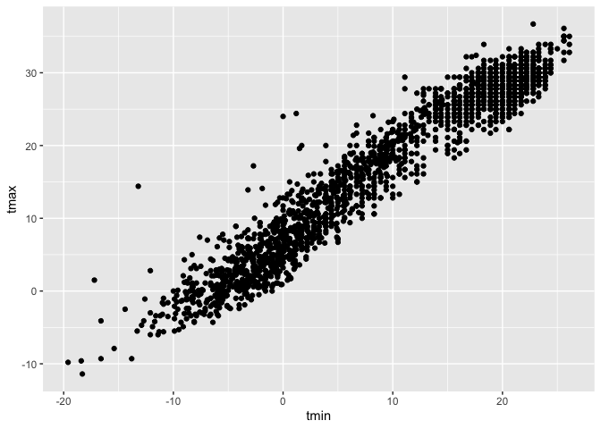
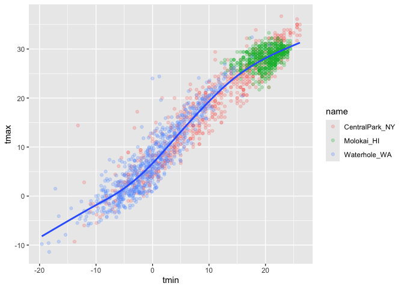
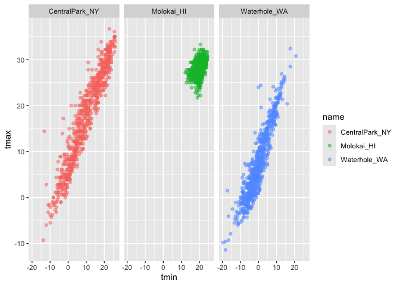
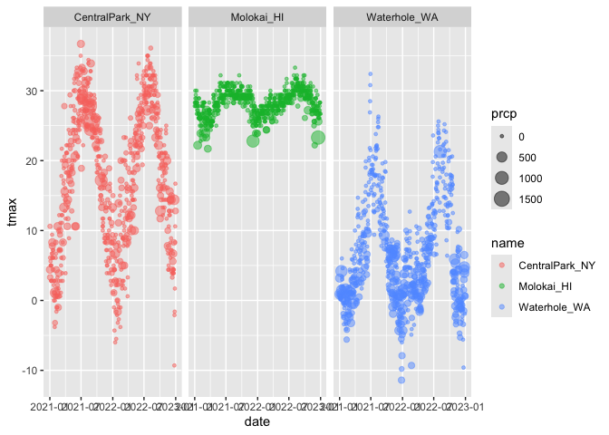

01_viz
================
2026-10-01

# make new repository

# make new project

# make new document r markdown

``` r
library(tidyverse) 
```

    ## ── Attaching core tidyverse packages ──────────────────────── tidyverse 2.0.0 ──
    ## ✔ dplyr     1.2.1     ✔ readr     2.2.0
    ## ✔ forcats   1.0.1     ✔ stringr   1.6.0
    ## ✔ ggplot2   4.0.3     ✔ tibble    3.3.1
    ## ✔ lubridate 1.9.5     ✔ tidyr     1.3.2
    ## ✔ purrr     1.2.2     
    ## ── Conflicts ────────────────────────────────────────── tidyverse_conflicts() ──
    ## ✖ dplyr::filter() masks stats::filter()
    ## ✖ dplyr::lag()    masks stats::lag()
    ## ℹ Use the conflicted package (<http://conflicted.r-lib.org/>) to force all conflicts to become errors

``` r
library(ggridges)
library(p8105.datasets)
data("weather_df")
```

Lets make a scatterplot

``` r
ggplot(weather_df, aes(x = tmin, y = tmax))+
  geom_point()
```

    ## Warning: Removed 17 rows containing missing values or values outside the scale range
    ## (`geom_point()`).

<!-- -->

``` r
ggp_temp_scatterplot = 
weather_df |> 
  ggplot(aes(x = tmin, y = tmax)) +
  geom_point(aes(color=name),alpha = 0.25 ) + 
  geom_smooth(se = FALSE)
             

ggp_temp_scatterplot
```

    ## `geom_smooth()` using method = 'gam' and formula = 'y ~ s(x, bs = "cs")'

    ## Warning: Removed 17 rows containing non-finite outside the scale range
    ## (`stat_smooth()`).

    ## Warning: Removed 17 rows containing missing values or values outside the scale range
    ## (`geom_point()`).

<!-- -->

show faceting

``` r
weather_df |> 
  ggplot(aes(x = tmin, y = tmax, color= name)) +
  geom_point(alpha = 0.5 ) + 
  facet_grid(. ~name) # column , old
```

    ## Warning: Removed 17 rows containing missing values or values outside the scale range
    ## (`geom_point()`).

<!-- -->

``` r
weather_df |> 
  ggplot(aes(x = tmin, y = tmax, color= name)) +
  geom_point(alpha = 0.5 ) + 
  facet_grid(cols = vars(name)) # new 
```

    ## Warning: Removed 17 rows containing missing values or values outside the scale range
    ## (`geom_point()`).

<!-- -->

``` r
weather_df |> 
  ggplot(aes(x = date, y= tmax, color = name)) + 
  geom_point(aes(size = prcp),alpha = 0.5) + 
  facet_grid(. ~name)
```

    ## Warning: Removed 19 rows containing missing values or values outside the scale range
    ## (`geom_point()`).

<!-- -->

make a plot of central park tmax v tmin onlu, convert temperatures to F

``` r
weather_df |> 
  filter(name == "CentralPark_NY") |>
  mutate(
    tmax = tmax *(9/5) + 32,
    tmin = tmin *(9/5) + 32
  )|>
  ggplot(aes(x = tmin, y= tmax)) + 
  geom_point()
```

<!-- -->
